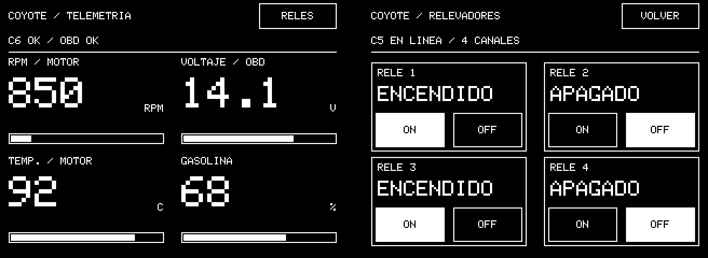

# COYOTE · dashboard ESP32 para Jeep

Seis OLED para mediciones OBD2, un mando TFT monocromo y cuatro relevadores
controlados por ESP-NOW. Tutorial en español basado en el prototipo construido,
con archivos para repetir el montaje y una ruta para hacerlo acompañado por
Codex, Claude Code u otro agente.



La imagen ilustra la interfaz; sus valores de demostración no son lecturas de tu vehículo.

## Resultado final

Visto de frente, con el USB del C6 a la derecha:

| Fila | Izquierda | Centro | Derecha |
| --- | --- | --- | --- |
| Arriba, OLED invertidas físicamente | Estado OBD2 · CH0 | Mal Camino · CH3 | Refrigerante · CH4 |
| Abajo | RPM · CH5 | Voltaje OBD · CH6 | Gasolina · CH7 |

El TFT muestra RPM, voltaje, refrigerante y gasolina; **RELES** abre cuatro
controles ON/OFF y **VOLVER** regresa. La interfaz se dibuja en RAM y envía
los cambios para evitar parpadeos. El arranque muestra Mal Camino y después
el Willys con rines de cinco rayos.

## Empieza aquí

1. [Componentes y variantes compatibles](docs/01-componentes.md).
2. [Conexiones y disposición de las OLED](docs/02-conexiones.md).
3. [Instalación y configuración del equipo](docs/03-preparacion.md).
4. [Tutorial de puesta en marcha, por etapas](docs/04-tutorial.md).
5. Si algo falla: [diagnóstico](docs/06-diagnostico.md).

**Con un agente:** abre la carpeta descargada en Codex o Claude Code y pega:

> Lee AGENTS.md, docs/CONTEXTO.md y docs/05-guia-agentes.md. Quiero reproducir
> COYOTE. Comprueba qué herramientas y placas tengo, crea mi bitácora local
> y acompáñame desde la primera etapa pendiente. Ejecuta lo que puedas verificar
> y pídeme solo los datos o comprobaciones físicas que te falten.

[Guía para agentes y continuación de sesiones](docs/05-guia-agentes.md).
`CLAUDE.md` importa `AGENTS.md`; ambos agentes parten del mismo contexto.

## Descargar

```sh
git clone https://github.com/soybisonte/coyote-dashboard.git
cd coyote-dashboard
```

También puedes usar **Code → Download ZIP** en GitHub y descomprimirlo.
Para cargar por USB, el agente necesita ejecutarse en una computadora con
acceso local a esas placas. En un entorno remoto puede preparar y compilar;
la persona ejecutará la carga localmente.

## Archivos del proyecto

| Carpeta | Placa / función |
| --- | --- |
| `XJ_Dashboard_C6/` | C6: seis OLED, BLE OBD2 y telemetría |
| `XJ_Mando_TFT/` | ESP32-2432S028, variante ST7789 de dos USB |
| `XJ_Relevadores_C5/` | ESP32-C5_Relay_X4, cuatro relevadores |
| `Prueba_Mapa_OLED_C6/` | Etiquetas temporales para identificar cada canal |
| `tools/` | Configuración, instalación, compilación y comprobaciones |
| `docs/` | Tutorial, arquitectura, evidencia y límites |

Los nombres `XJ_*` son rutas históricas de Arduino; el nombre visible es **COYOTE**.
Este repositorio contiene la versión final seleccionada, sin el historial de
pruebas antiguas, copias de flash ni datos particulares del equipo original.

## Antes de cargar

Configura **tus propias MAC** siguiendo la guía. Las direcciones incluidas son
plantillas vacías y las salidas del C5 se distribuyen bloqueadas. Para habilitarlas
se declara la placa exacta y se cambia una opción en la configuración local.
Las primeras pruebas se realizan por USB, con las bornas de carga vacías.
No es una guía para cablear accesorios a 12 V ni para funciones críticas del vehículo.

[Estado de validación y limitaciones](docs/07-validacion.md) ·
[Arquitectura](docs/08-arquitectura.md) · [Licencia MIT](LICENSE) ·
[Logos y terceros](NOTICE.md).
