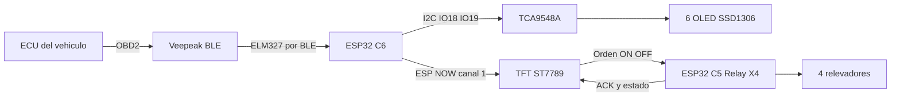

# 8. Arquitectura y archivos que deben coincidir

No hay backend, router ni dependencia de Internet durante la operación.
Los agentes se usan para instalar/desarrollar; no corren en los ESP32.

| Mensaje | Versión / tamaño | Uso |
| --- | --- | --- |
| DashboardPacket | v3, 32 bytes | RPM, voltaje, refrigerante, gasolina y flags de vigencia |
| ArranqueRadio::Packet | v2, 12 bytes | Sesión y cuadro de la intro/animación |
| Relevadores::Paquete | v1, 20 bytes | Orden explícita, ACK y estado de cuatro GPIO |

Mantén idénticos `Arranque_XJ.h`, `Arranque_Radio.h`, `Logo_Willys.h` y
`Logo_Mal_Camino.h` entre C6/TFT; también `Relevadores_Protocolo.h` entre
C5/TFT. Las tres copias de `Configuracion_Radio.h` deben coincidir. El
verificador comprueba esas igualdades.

La UI del TFT dibuja en `GFXcanvas1` y `Pantalla_Diferencial.h` transfiere
solo tramos modificados. La animación inicial sigue su propio dibujado y,
al terminar, invalida el presentador. Evitar que logs o tareas BLE bloqueen
el control: OBD corre en su tarea y el C5 descarta logs que no caben en USB.
